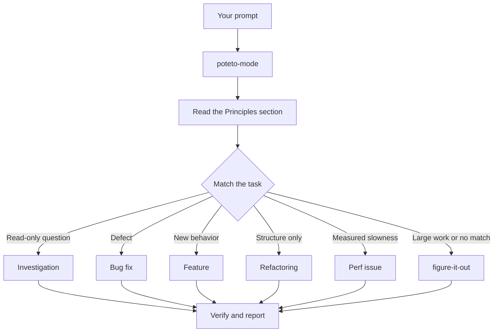

# `/poteto-mode`를 통해 작업 라우팅하기

`/poteto-mode`는 정문입니다. 목표를 주면 23개의 플레이북 중 하나를 매칭하고, 그 플레이북의 단계들을 할 일 목록에 복사해 넣은 뒤, 각 단계에 필요한 다른 스킬들을 호출합니다. 이 페이지에서는 좋은 프롬프트가 어떤 모습인지, 그리고 실제로 얼마나 짧게 적어도 충분한지 알아봅니다.


## 프롬프트가 처리되는 과정



다이어그램은 자주 쓰이는 경로들을 보여줍니다. 이 밖에도 지표 힐클라이밍(hillclimbing), 런타임 증상 및 캡처된 트레이스 진단, 프로토타입 제작, 시각적 동등성(visual parity) 확보, 스킬 작성 및 평가, 자율 실행(autonomous run), PR 열기, PR이나 스택을 머지 준비 상태까지 돌보기(babysitting), 검증된 스택 배포(shipping), 오토파일럿으로 PR 큐나 스택 실행, 프로젝트 규모 프로그램 조율(orchestrating), 세션 이어받기(session pickup), 안전하게 일시 중지(pausing safely), 다단계 계획(multi-phase plans), 워크트리 정리(worktree cleanup)를 위한 플레이북들이 준비되어 있습니다. 전체 목록은 [플레이북 디렉터리](../../skills/poteto-mode/playbooks/)에서 확인할 수 있습니다.

## 형식이 아니라 목표를 말하세요

명세서를 작성할 필요는 없습니다. 무엇이 잘못되었는지 또는 무엇을 원하는지 말하고, 에이전트의 시간을 아껴줄 수 있도록 이미 알고 있는 정보만 덧붙이면 됩니다:

```text
/poteto-mode users get two notifications after a retry. repro first, then fix and verify.
```

이것이 전형적인 Bug fix 프롬프트입니다. "repro first(먼저 재현할 것)"는 단순한 인사말이 아니라 실질적인 제약 조건이며 플레이북은 이를 존중합니다. 할 일 목록이 Bug fix 단계들로 채워지는 것을 확인해 보세요. 건너뛴 단계는 `skip: <reason>`과 함께 눈에 보이게 유지됩니다.

## 프롬프트에 담을 내용

유용한 프롬프트는 최대 다섯 가지 요소를 담으며, 각각은 한 문장이면 충분합니다:

- **목표(The goal).** 무엇이 잘못되었는지, 또는 무엇을 원하는지 말합니다.
- **완료 조건(The done check).** 통과 또는 실패를 판별할 수 있어야 합니다. "더 좋게 만들어줘"나 "한 시간 동안 작업해줘"는 완료 조건이 아닙니다.
- **확인하고 싶은 증거(The proof you want to see).** 실제 명령어 출력, 플로우 녹화 비디오, 저장된 값 또는 전후 비교 수치를 요청합니다.
- **이미 알고 있는 사실(What you already know).** 증상, 재현 단계, 로그 한 줄 또는 링크 하나가 에이전트의 탐색 시간을 덜어줍니다.
- **실질적인 제약 조건(The real constraints).** "repro first", "don't change any code yet", "zero behavior change", "let me review before proceeding"는 각각 에이전트의 행동을 바꿉니다.

다섯 가지를 모두 담은 프롬프트 예시입니다:

```text
/poteto-mode the csv export drops its last row since yesterday's deploy. failing job id is 4812. repro first, then fix. done means the 60k-row fixture exports every row. show me the row counts before and after.
```

반면 다음 두 가지는 빼는 편이 좋습니다:

- **구현 방법(The how).** 무엇을 달성해야 하는지만 말하고, 여러분이 고를 법한 경로보다 더 나은 경로를 에이전트가 찾을 수 있도록 여지를 남겨두세요. 아래 함정(pitfall)에서 다루겠지만 스킬 목록을 직접 나열하는 것도 마찬가지입니다.
- **처음부터 원인을 단정 짓는 가설(Your theory of the cause, at first).** 추측을 먼저 말해버리면 탐색 범위가 여러분이 가리킨 곳으로 좁아집니다. 여러분의 직감을 공유하기 전에 에이전트가 먼저 문제를 자신의 말로 재진술하게 하세요.

긴 스레드나 모호한 버그처럼 잡음이 많은 제보의 경우 재진술(restatement)을 첫 단계로 삼으세요:

```text
/poteto-mode read this thread. restate the underlying issue in your own words, in plain english. don't change any code yet.
```

오독이 있다면 코드가 작성되기 전에 재진술에서 드러납니다. 거기서 바로잡으면 잘못된 수정 하나 대신 메시지 하나로 끝납니다. 플레이북 없이 재진술만 받고 싶다면 [`/in-your-own-words`](../../skills/in-your-own-words/SKILL.md)를 실행하세요. 에이전트가 파악한 여러분의 목표와 해결하려는 문제가 무엇인지 다시 설명해 줍니다.

프롬프트가 제대로 조준되었는지 확신이 서지 않을 때는 보내기 전에 [`/sharpen`](../../skills/sharpen/SKILL.md)을 실행해 보세요:

```text
/sharpen write a migration guide for the v2 config format.
```

에이전트는 최고 수준의 전문가라면 여러분이 요청하지 않았더라도 챙겼을 사항, 출발점으로 삼을 가장 날것의 원재료, 사용할 방법론과 도구, 그리고 여러분이나 에이전트가 아닌 외부에서 결과가 맞음을 입증해 줄 기준을 짚어줍니다. 그런 다음 정확히 그것을 요청하도록(길이를 늘리는 대신 깊이를 더해) 프롬프트를 다시 작성해 돌려주며 선택권은 열어 둡니다. 과업 자체를 수행하지는 않습니다. 다시 작성된 프롬프트를 읽고 마음에 들면 예를 들어 `/poteto-mode`와 함께 전송하세요.

## 후속 지시는 짧게

대화에 이미 맥락이 담겨 있을 때는 프롬프트가 거의 아무것도 없는 수준으로 줄어듭니다. 다음 표현들만으로도 충분합니다:

```text
/poteto-mode do it
```

```text
continue
```

```text
keep going until done
```

짧은 지시가 통하는 이유는 플레이북이 구조를 붙잡고 있고, 커스텀 모드가 매 턴마다 `/poteto-mode`를 컨텍스트에 유지해 주기 때문입니다. 커스텀 모드를 시작하는 방법은 [pstack 설정하기](./01-setup.md#run-your-first-task)에 나와 있습니다. 여러분의 말은 의도를 나르고, 스킬은 엄격함을 나릅니다.

## "new task"로 과업 전환하기

긴 채팅에는 이전 과업의 맥락이 쌓입니다. 주제를 바꿀 때는 명시적으로 말하세요:

```text
/poteto-mode new task. figure out why the cache entry survives logout. don't change any code yet.
```

"new task"는 `/poteto-mode`에게 이전 플레이북을 이어가는 대신 새로 매칭하라고 알려줍니다. "don't change any code yet"은 이번 과업을 Investigation 플레이북으로 고정합니다. 이 두 문구가 없으면 Feature 플레이북을 진행 중이던 모드는 여러분의 질문을 다음 기능 구현 단계로 취급하는 경향이 있습니다.

## 병렬 작업에는 독립된 작업 공간 부여하기

한 컴퓨터의 단일 저장소에 여러 에이전트를 동시에 실행하면 워킹 트리, 포트, 빌드 출력을 두고 서로 충돌하게 됩니다. 가장 깔끔한 격리 수단은 [클라우드 서브에이전트(cloud subagent)](https://cursor.com/docs/subagents#cloud-subagents)입니다. 각 에이전트가 고유한 VM과 브랜치를 할당받으므로 여러분의 로컬 머신을 건드리지 않고 의존성을 설치하고, 앱을 실행하며, 결과 비디오를 녹화할 수 있습니다. 과업 앞에 `/in-cloud`를 입력하거나 부모 채팅에게 작업을 클라우드 서브에이전트에 넘기라고 요청하세요.

작업을 로컬에 두어야 할 때는 처음부터 워크트리(worktree)를 요청하세요:

```text
/poteto-mode new task. branch off <base> in a fresh worktree, then port the parser change there.
```

각 과업이 고유한 브랜치와 워크트리에서 돌아가면 에이전트가 다른 에이전트의 파일을 덮어쓸 일이 없습니다. 워크트리는 디스크와 머신 리소스를 소비하므로 노트북에서는 한 번에 몇 개 정도만 실행할 수 있습니다. [Opening a PR 플레이북](../../skills/poteto-mode/playbooks/opening-a-pr.md)은 이미 코드 변경 작업을 워크트리에서 수행하므로, 주로 특정 베이스 브랜치나 위치가 중요할 때만 이를 명시하면 됩니다.

워크트리는 시간이 지나면 쌓입니다. 디스크 공간이 부족해지면 다음과 같이 요청하세요:

```text
/poteto-mode what's eating my disk? prune the worktrees that are safe to prune.
```

[Worktree cleanup 플레이북](../../skills/poteto-mode/playbooks/worktree-cleanup.md)은 모든 워크트리를 머지 상태, 커밋되지 않은 작업 유무, 그리고 어떤 채팅이 아직 해당 워크트리를 참조하고 있는지에 따라 분류합니다. 증거상 안전하다고 확인된 것만 삭제하며, 커밋되지 않은 작업이 남아 있는 워크트리는 일시 중지하고 여러분의 결정을 기다립니다.

## 켜 두고 자리 비우기

자리를 비울 때는 완료의 의미만 말해주고 떠나면 됩니다:

```text
/poteto-mode im stepping away. keep going until the migration check reports zero old callers. log your decisions.
```

나중에 돌아와서 검토할 작업은 [`/figure-it-out`](../../skills/figure-it-out/SKILL.md)을 통해 라우팅되며, 이 스킬이 실행 단계들을 설계하고 [`/show-me-your-work`](../../skills/show-me-your-work/SKILL.md) 의사결정 로그를 기록합니다. 전체 야간 자율 실행 계약은 [잠든 사이에 작업 실행하기](./07-overnight.md)에서 다룹니다.

**함정(Pitfall):** 프롬프트에 스킬들을 일일이 나열하지 마세요("use /how, then /architect, then /arena..."). 플레이북이 이미 적절한 순서로 스킬들을 배치해 두고 있으며, 수작업으로 적는 순서는 대개 플레이북이 지켰을 단계들을 뒤섞거나 빠뜨리게 됩니다. 특정 선택을 오버라이드하고 싶을 때만 스킬 이름을 직접 언급하세요.

전체 라우팅 규칙은 [`poteto-mode`](../../skills/poteto-mode/SKILL.md) 본문에서 확인할 수 있습니다.

다음: [코드 이해하기](./03-understand.md).
