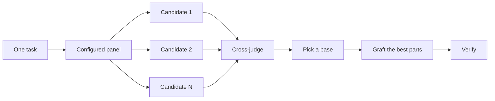

# 코드를 작성하기 전에 설계하기

까다로운 설계를 단 한 번의 시도로 끝내버리면 모델이 처음 떠올린 형태에 그대로 갇히게 됩니다. `/architect`는 구현에 앞서 타입과 경계를 확정합니다. `/arena`는 동일한 브리핑에 대해 여러 번의 시도를 병렬로 실행한 뒤 가장 좋은 부분들을 합칩니다. `/interrogate`는 다른 모델들을 투입해 결과를 깨뜨려 보게 합니다. 과업이 설계 합성이 아니라 커버리지 확보에 있을 때는 `/swarm`이 여러 슬라이스나 경합(race) 부문을 병렬로 펼쳐 결과를 집계합니다.

가장 흔한 두 가지 설계 실수는 에이전트의 첫 번째 설계안을 그대로 받아들이는 것과 아무런 코드로도 테스트해 보지 않은 계획서를 다듬는 것입니다. 이 페이지는 그 두 가지를 모두 바로잡습니다. 계획은 코드를 통해 세웁니다. 프로토타입이 열린 질문에 답하고, README나 튜토리얼이 목표를 설정하며, 문서화된 계획은 가장 마지막에 나옵니다.


## `/architect`로 형태 확정하기

```text
/architect design the import pipeline before writing any code. i care most about how callers use it.
```

[`/architect`](../../skills/architect/SKILL.md)는 먼저 기반을 다집니다. 설계가 건드리는 코드에 대해 `/how`를 실행하고, 소유권이나 계층을 이동시키는 경우 `/why`를 실행합니다. 그런 다음 `/arena`를 실행해 경쟁하는 설계 스케치들을 만들어내는데, 각 스케치에는 호출자의 사용 예시가 가장 먼저 적히고 그 뒤로 타입, 시그니처, 모듈 맵이 이어집니다.

기본적으로는 합성된 설계에서 곧바로 구현까지 진행합니다. 구현 전에 설계를 먼저 눈으로 확인하고 싶다면 명시적으로 말하세요:

```text
/architect with checkpoint. stop and show me before implementing.
```

코드 작성이 시작되었다고 해서 설계가 신성불가침이 되는 것은 아닙니다. 구현 도중 서로 관련 없는 곳에서 동일한 임시방편(workaround)이 반복되거나 `any` 또는 강제 캐스팅을 써야만 컴파일되는 타입이 나타난다면, `/architect`는 이를 설계가 틀렸다는 증거로 취급합니다. 그 주변을 땜질하는 대신 스케치를 폐기하고 처음부터 다시 시작합니다.

## `/arena`로 여러 시도 펼치기

```text
/arena take my prompt to the arena verbatim. i want to compare their proposals with yours.
```

[`/arena`](../../skills/arena/SKILL.md)는 그 기저에 있는 범용 도구입니다. N개의 서브에이전트가 각각 고유한 워크트리나 디렉터리에 작업하며 동일한 설계 또는 코드 브리핑을 병렬로 시도합니다. 다른 모델 패밀리에 속한 읽기 전용 심사위원(judge)이 루브릭에 따라 모든 후보에 점수를 매깁니다. 다른 패밀리의 모델을 실행할 수 없는 경우 코디네이터는 심사위원을 건너뛰고 직접 베이스를 고릅니다. 코디네이터는 각 후보를 처음부터 끝까지 읽고, 베이스 하나를 고른 뒤, 탈락한 후보들에서 가장 훌륭한 아이디어들을 접목(graft)하고 결과를 검증합니다.



패널 구성은 [`/setup-pstack`](../../skills/setup-pstack/SKILL.md) 설정에서 가져오며 과업마다 조정할 수 있습니다. 결정이 중요할 때는 더 많은 후보를 요청하고, 그렇지 않을 때는 줄이세요:

```text
/arena this, 5 candidates. the cache key format is expensive to change later.
```

## `/swarm`으로 슬라이스 및 경합 다루기

```text
/swarm check every package under packages/ against its check.sh. one worker per package. one report.
```

[`/swarm`](../../skills/swarm/SKILL.md)은 독립적인 슬라이스, 커버리지 매트릭스, 건틀릿(gauntlet) 레인, 탐색 파티션 또는 선언된 경합 부문들에 N개의 워커를 펼칩니다. 각 워커는 고유한 범위와 검사 기준을 할당받은 뒤 `PASS`, `ISSUES`, 또는 `BLOCKED`를 보고합니다. 부모 에이전트는 워커들을 기다렸다가 누락이나 중도 탈락을 포함한 간결한 보고서 하나를 반환합니다.

병렬화를 통해 커버리지를 확보하거나 독립적인 검사들을 경합시키고 싶을 때 이 스킬을 찾으세요. `/arena`는 모든 워커에게 동일한 설계나 코드 브리핑을 준 뒤 베이스를 고르고 장점을 접목합니다. 반면 `/swarm`은 슬라이스들을 나누어 맡거나 사전에 선언된 선택 규칙에 따라 경합을 벌이며, 베이스 선택 및 접목 절차를 거치지 않습니다.

## `/interrogate`로 깨뜨려 보기

```text
/interrogate the whole branch, but skeptically. no nitpicks unless it's an actual bug or regression.
```

[`/interrogate`](../../skills/interrogate/SKILL.md)는 설정된 모델들로 구성된 적대적 검증자(adversaries)들에게 변경 사항과 그 의도를 넘겨주고, 각 검증자가 실제 코드에 대해 실행을 돌려 이를 깨뜨려 보게 합니다. 검증자들은 서로 다른 실패 지점을 찾아냅니다. 발견 사항은 해당 명령어를 다시 실행했을 때 의도를 깨뜨리는 실패가 실제로 재현되는 경우에만 살아남습니다. 보고서는 검증된 모든 발견 사항과 이를 찾아낸 검증자들을 나열하고, 이어서 각 검증자가 기각(drop)한 항목과 그 이유를 보여준 뒤, 코드에는 아무것도 직접 적용하지 않습니다.

기각된 목록(Dropped list)도 함께 읽어보세요. 판정을 뒤집는 것은 여러분의 몫입니다.

## 논쟁하는 대신 프로토타입 만들기

첫 번째 설계안을 절대 그대로 채택하지 마세요. 몇 가지 옵션을 요청하고 눈으로 확인할 수 있는 증거를 바탕으로 고르세요:

```text
/poteto-mode prototype a few options for the new dropdown menu. take screenshots or videos for me to compare.
```

[Prototype 플레이북](../../skills/poteto-mode/playbooks/prototype.md)은 스크래치 디렉터리에 일회용 스케치들을 만들고, 하나의 스위처(switcher) 뒤에 배리언트들을 배치한 뒤, 각각을 구동하여 스크린샷이나 소요 시간을 캡처합니다. UI뿐만 아니라 동작 방식이나 알고리즘에도 그대로 작동합니다. 프로토타입은 코드로 세우는 계획입니다. 에이전트가 여러분에게 물어보는 대신 무언가를 직접 실행해 봄으로써 열린 질문에 스스로 답하게 해 주며, 여러분이 미처 생각하지 못했을 옵션이 등장할 여지를 남겨줍니다.

같은 아이디어를 본격적인 설계로 확장할 수도 있습니다. `/architect`를 프로토타입과 짝지어 사용하고 리뷰 게이트를 두세요:

```text
/poteto-mode we need rate limiting for external webhooks. /architect it first, and answer open questions with prototypes. let me review before proceeding.
```

추상적인 계획서에 적대적 검증자들을 낭비하지 마세요. `/interrogate`는 실제 실행으로 입증되지 않는 모든 지적 사항을 기각하므로, 뒤에 코드가 없는 계획서는 그들에게 깨뜨릴 거리를 거의 주지 못합니다. 프로토타입으로 질문들을 먼저 해결한 다음 실제로 만들어진 결과물을 리뷰하세요.

## 공유 코드는 README부터 먼저 작성하기

다른 코드가 가져다 쓸 패키지나 API의 경우 사용자가 읽게 될 문서부터 시작하세요:

```text
/poteto-mode write a tutorial for how i would use the new config package first. then /teach me why it beats the current one.
```

튜토리얼을 먼저 작성하면 호출자의 관점이 강제됩니다. 가상의 사용자에게 API를 설명한 뒤 거기서부터 거꾸로 구현을 향해 나아가는 것입니다. 또한 그 문서는 에이전트가 자신의 작업을 대조해 볼 구체적인 목표물이 됩니다. 문서 자체의 품질이 중요할 때는 [`/technical-writing`](../../skills/technical-writing/SKILL.md)을 명시하여 튜토리얼이 레퍼런스나 설명 문서와 뒤섞이지 않고 온전한 튜토리얼로 유지되게 하세요.

## 설계가 자리 잡은 후에 계획 세우기

pstack에는 의도적으로 계획(planning) 스킬을 두지 않았습니다. 문서화된 계획서가 정말 필요할 때는 설계가 자리 잡은 후에 요청하세요:

```text
/poteto-mode turn this design into a plan. small verifiable PRs, each with its own verification steps.
```

[Multi-phase plan 플레이북](../../skills/poteto-mode/playbooks/multi-phase-plan.md)은 남아 있는 열린 질문들을 프로토타입으로 해결한 다음, PR당 하나의 섹션을 작성하며 각 섹션은 변경 사항이 작동한다는 증명으로 끝납니다. 단순히 테스트 스위트가 통과한다는 것만으로는 그 증명으로 인정되지 않습니다. 이 플레이북에서는 계획서 자체가 최종 산출물입니다. 직접 구현하지는 않으며, 다음에 어떤 실행 플레이북이 이를 이어받아 실행해야 하는지 명시합니다.

마이그레이션의 경우 프롬프트에 기준선을 명확히 밝히세요:

```text
/poteto-mode plan the migration of our ui library to the new styling system. small verifiable PRs, each with visual regression checks. the result must match the original exactly, bugs included.
```

"bugs included(버그까지 포함해서)"라는 조건은 마이그레이션 도중 은근슬쩍 기존 동작을 고쳐버려 이전 출력과 새 출력을 비교할 수 없게 만드는 일을 막아줍니다. 며칠에 걸쳐 진행되는 프로젝트의 경우 다른 에이전트들이 진행 중인 작업을 볼 수 있도록 계획서를 저장소에 잠시 커밋해 둘 수 있습니다. 작업이 랜딩되면 계획서는 삭제하세요.

## 과업에 어느 정도의 설계 작업이 적당할까요?

모든 변경마다 이 과정을 다 거쳐야 하는지 궁금할 수 있습니다. 아닙니다. 대부분의 변경에는 이 중 아무것도 필요하지 않습니다. 대략적인 기준 사다리는 다음과 같습니다:

- 작고 이미 완성된 변경이지만 확신이 서지 않는 경우: `/interrogate`만 단독으로 씁니다.
- 함수 경계를 넘나들거나 소유권을 이동시키는 변경: `/arena`를 함께 동반하는 `/architect`를 쓸 만합니다.
- 이름 짓기, 포맷, 알고리즘처럼 독립적인 여러 시도가 도움이 되는 단일 의사결정: `/arena`를 직접 씁니다.
- 커버리지 매트릭스, 병렬 검사 세트 또는 부문이 선언된 경합: `/swarm`을 씁니다.
- 레이아웃, 타이밍, 접근 방식처럼 무언가를 직접 실행해 봄으로써 답을 얻을 수 있는 열린 질문: 논쟁 대신 프로토타입을 만듭니다.
- 되돌리는 비용이 크고 논쟁의 여지가 있는 설계: 배포 전에 `/architect`를 거친 뒤 `/interrogate`를 실행합니다.
- 여러 PR에 걸쳐 진행되는 작업: 설계가 자리 잡은 후에 작성하는 계획서를 씁니다.

`/poteto-mode`는 이미 이 사다리를 적용하고 있습니다. 경계를 가로지르는 작업은 알아서 `/architect`를 트리거하므로, 이 스킬들을 직접 호출하는 것은 주로 기본값보다 더 강하거나 더 가벼운 검증을 원할 때뿐입니다.

다음: [변경 사항 구현 및 정리하기](./05-build-and-clean.md).
