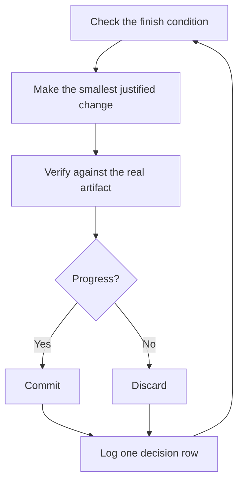

# 잠든 사이에 작업 실행하기

지금까지 다룬 모든 과정의 보상이 여기에 있습니다. 스스로 작업을 검증할 수 있다고 신뢰할 수 있는 에이전트는 어려운 과업을 맡겨 두고 자리를 비울 수 있는 에이전트입니다. 이를 안전하게 만드는 것은 막연한 희망이 아닙니다. 확인 가능한 완료 조건, 격리된 워크트리나 클라우드 에이전트, 그리고 아침에 여러분이 감사(audit)할 수 있는 의사결정 로그입니다.


## 루프를 돌리기 전에 신뢰부터 확보하기

신뢰할 수 없는 루프는 미검증 작업물을 더 빠르게 찍어낼 뿐이며, 반복할수록 혼란이 눈덩이처럼 불어납니다. 루프를 켜 두고 떠나기 전에 루프가 그럴 자격을 갖추었는지 확인하세요:

- 좋은 결과물이 어떤 모습인지 알 수 있도록 여러분이 직접 수작업으로 한 번 해봤거나 에이전트가 수행하는 것을 지켜본 적이 있습니다.
- 에이전트가 여러분이 직접 사용할 법한 도구와 신호(검증 스킬, 프로파일러, 로그)를 갖추고 있습니다.
- 모든 단계가 자신의 작업을 증명하며 기준에 미달할 때 라인을 멈출 수 있습니다.
- 몇 차례 트랜스크립트를 읽어보며 반복되는 실패들을 도구, 스킬 또는 검사로 전환해 두었습니다.

이 네 가지가 모두 충족된 후에만 루프를 자율 실행으로 전환하세요. 그전까지는 직접 지켜보는 상태에서 실행하세요.

## 야간 자율 실행 계약 (The overnight contract)

좋은 인계 프롬프트에는 목표, 완료 조건, 권한, 그리고 탈출구(escape hatch)가 담깁니다. 길 필요는 없습니다:

```text
/poteto-mode im going to bed. migrate every caller to the new parser in a fresh worktree off <base>.
done means zero old callers, all parser fixtures pass, old api deleted.
keep a decision log. don't ask me before committing.
/loop until done. if you're truly stuck after a few hours, stop and write up why.
```

각 줄이 어떤 역할을 하는지 살펴보겠습니다:

- "im going to bed"는 세션 오버라이드입니다. 에이전트가 질문을 멈추고 계속 나아갑니다.
- "done means..."는 목표를 매 반복(iteration)마다 실행할 수 있는 검사들로 바꿔줍니다.
- "fresh worktree off `<base>`"는 이번 실행이 여러분이 열어 둔 다른 작업들과 충돌하지 않게 막아줍니다.
- "don't ask me before committing"은 에이전트가 물어보느라 멈춰 섰을 권한 요청에 미리 답해 둡니다.
- `/loop`는 pstack 스킬이 아니라 Cursor의 내장 깨우기(wake) 메커니즘입니다. [Autonomous run 플레이북](../../skills/poteto-mode/playbooks/autonomous-run.md)은 이를 사용해 이벤트나 하트비트마다 완료 조건을 다시 확인합니다.
- 탈출구는 진짜 막다른 길에 부딪혔을 때 멈추고 그 이유를 적어두게 하는데, 여덟 시간 동안 창의적으로 목표를 왜곡해 가며 헛돌게 두는 것보다 훨씬 낫습니다.

자리를 비운 뒤 나중에 돌아와서 이 작업을 검토하게 되므로, `/poteto-mode`는 이를 [`/figure-it-out`](../../skills/figure-it-out/SKILL.md)을 통해 라우팅하여 코드를 작성하기 전에 실행 단계들을 설계하고 의사결정 로그를 연결합니다.

의도적으로 실행을 멈추려면 에이전트에게 일시 중지(pause)하라고 말하거나 곧 오프라인이 되거나 Cursor를 재시작할 것이라고 알려주세요. [Pause safely 플레이북](../../skills/poteto-mode/playbooks/pause-safely.md)은 현재 단계를 마무리하거나 깔끔하게 되돌리고, 작업 중(WIP) 체크포인트를 커밋한 뒤 재개 메모를 작성합니다. 새로운 채팅은 Session pickup 플레이북을 통해 그 메모로부터 작업을 이어받습니다. "keep going"이라고 말하는 것은 절대 일시 중지를 트리거하지 않습니다.

## 밤새 루프가 하는 일



매 반복마다 하나의 변경, 하나의 검사, 하나의 로그 행을 남깁니다. 도움이 되지 않은 변경은 방치하지 않고 즉시 폐기합니다. 정체기(plateau)에 접어들면 멈추는 대신 방향을 전환(pivot)하며, 승리를 선언하기 위해 완료 조건을 슬그머니 낮추는 일은 절대 없습니다.

## 아침 감사 (The morning audit)

실행 결과를 리뷰 가능하게 만들어 주는 것은 [`/show-me-your-work`](../../skills/show-me-your-work/SKILL.md)입니다. 각 행은 시각, 단계, 결정, 이유, 증거 포인터 및 결과를 `decisions.tsv`(또는 여러 실행이 디렉터리를 공유할 때는 `.audit/<task-slug>.tsv`)에 TSV 형식으로 기록합니다. 기본적으로는 로컬 파일로 유지됩니다. 리뷰어가 결과를 신뢰하기 위해 의사결정 경로를 확인해야 할 만큼 야심 찬 작업일 때는 이 파일을 커밋하세요.

돌아와서는 리뷰 형태로 실행 요약을 요청하세요:

```text
/show-me-your-work catch me up on what you did last night
```

스킬은 요약본을 돌려주기 전에 다른 모델 패밀리의 리뷰어를 스폰하여 의사결정 기록과 트랜스크립트를 읽게 하며, 응답 마지막에는 여러분이 면밀히 살펴봐야 할 항목들을 나열한 Attention 섹션을 덧붙입니다. 그 섹션을 먼저 읽고 거기서 가리키는 로그 행들을 확인하세요. 밤새 일어난 모든 일을 처음부터 다시 읽는 것이 아니라 핵심 의사결정들을 감사하는 것입니다.

감사 대신 빠른 현황 파악만 원한다면 작업을 실행한 채팅에서 [`/ketchup`](../../skills/ketchup/SKILL.md)을 실행하세요. 읽기 전용으로 작동하며, 마지막 메시지 이후 무엇이 바뀌었는지 작업이 만들어낸 스크린샷 및 작은 다이어그램과 함께 평이한 말로 알려줍니다. 그런 다음 머지, 승인, 옵션 선택 등 여러분의 결정을 기다리는 각 사안을 추천 선택지, 증거, 위험 요소와 함께 나열해 주므로 응답만 보고도 바로 결정을 내릴 수 있습니다.

## 밤사이 처리할 대상이 단일 과업이 아니라 큐(queue)일 때

위의 계약은 하나의 과업을 하나의 완료 조건으로 몰고 갑니다. 어떤 밤에는 그보다 더 많은 것, 즉 독립적인 변경들의 큐나 전체 프로그램을 처리해야 할 때가 있습니다. 세 가지 플레이북이 동일한 신뢰 구조를 더 큰 규모로 확장해 줍니다.

[Autopilot-full](../../skills/poteto-mode/playbooks/autopilot-full.md)은 독립적인 PR들의 큐를 머지까지 실행합니다. 각 PR에는 빌드부터 머지까지 책임지는 오너 에이전트가 하나씩 배정되며, 어떤 오너도 자신의 자체 판정만으로 머지하지 않습니다. 새로운 검증자들로 구성된 스웜(swarm)이 오너의 코드 준비가 끝난 헤드를 검사합니다. 이후의 리베이스나 사소한 수정은 새로운 검증자 하나가 검사하며, 새로운 동작이나 대규모 diff가 추가된 경우에만 전체 스웜을 다시 호출합니다. 머지될 바로 그 패치에 대해 깨끗한 판정이 나왔을 때만 머지가 승인됩니다:

```text
/poteto-mode full autopilot on this queue. each item is independent. i want them merged by morning.
```

[Autopilot-stack](../../skills/poteto-mode/playbooks/autopilot-stack.md)은 머지만 제외한 Autopilot-full입니다. 아침에 일어나면 각각 판정 결과가 첨부된 검증 완료 PR들이 준비되어 있으며, 여러분이 직접 리뷰하고 랜딩합니다. PR은 자신이 기반을 둔 PR 위에만 스택으로 쌓입니다. 무언가 머지되기 전에 직접 눈으로 확인하고 싶을 때는 Autopilot-full 대신 이 플레이북을 고르세요:

```text
/poteto-mode autopilot these five changes, but don't merge. i'll land them in the morning.
```

[Orchestrate](../../skills/poteto-mode/playbooks/orchestrate.md)는 단일 에이전트의 수명을 넘어서는 프로그램(며칠에 걸친 작업, 다수의 스택 PR, 하나의 상시 코디네이터 채팅 아래 움직이는 서브에이전트 함대)을 위한 플레이북입니다. 코디네이터는 각 작업 조각을 어느 에이전트가 맡을지 결정하고 각 에이전트가 만든 결과물을 검사하며, 직접 코드를 작성하는 일은 절대 없습니다. 단일 에이전트가 한 세션 안에 끝낼 수 있는 작업이라면 플레이북 자체가 위의 야간 자율 실행 계약으로 다시 라우팅합니다:

```text
/poteto-mode orchestrate the store migration. own it until every package is converted and merged. i'll check in twice a day.
```

## 여러 프로젝트를 병렬로 실행하기

[Cursor Project](https://cursor.com/blog/projects)는 하나의 코디네이터 에이전트에게 영구적인 스레드를 부여합니다. 코디네이터는 코드를 직접 작성하지 않습니다. 대신 기본적으로 클라우드에서 실행되는 서브에이전트들을 지휘하므로 노트북을 덮어도 작업이 계속 진행됩니다. 이것이 바로 Orchestrate 플레이북이 상정하는 형태입니다. 코디네이터에게 보내는 프롬프트를 `/poteto-mode`로 시작하면 코디네이터가 스폰하는 서브에이전트들이 플레이북을 따릅니다.

다음 습관들이 도움이 됩니다:

- 기능 개발, 마이그레이션, 성능 개선, 기술 부채 정리 등 각 작업 덩어리마다 고유한 Project를 부여하세요. 여러 프로젝트를 나란히 실행할 수 있습니다.
- 이미 완료된 채팅을 포함해 관련된 채팅들을 Project 안으로 드래그해 넣으세요. 그 안의 모든 에이전트에게 맥락으로 제공됩니다.
- 머지 전에 각 PR에 검증 스웜을 붙이고, Autopilot-stack이나 Autopilot-full이 큐를 운반하게 하세요.
- 코디네이터에게 데이터로 뒷받침된 계획서를 요청하고, 여러분에게 물어보기 전에 프로토타입으로 열린 질문들에 먼저 답하게 하세요.

단 하나의 프롬프트로 리서치부터 실행까지 전체 Project를 이끌 수도 있습니다:

```text
/poteto-mode refactor this repo so its architecture is more agent friendly. use /correct and /architect on past commits and review comments to find the mistakes agents make most here. use /recall for context from past chats. answer open questions with prototypes instead of asking me. come back with a plan backed by real data. once i approve it, run it with autopilot-stack or autopilot-full, and ask me which.
```

## 루프가 스스로 시작되게 만들기

위의 모든 루프는 여전히 여러분이 시작해 주기를 기다립니다. 스케줄링되거나 이벤트에 의해 구동되는 자동화(automation)는 그 단계마저 제거합니다. 소프트웨어 유지보수는 제보 트리아지 → 재현 → 수정 → 수정 검증처럼 이 방식에 잘 들어맞는 단계들로 나뉩니다. 다음 두 가지 규칙이 이러한 파이프라인의 신뢰성을 지켜줍니다:

- 모든 단계가 라인을 멈출 수 있어야 합니다. 트리아지는 제보된 내용이 의도된 정상 동작이라고 판단할 수 있고, 재현 단계는 재현에 실패할 수 있으며, 수정 에이전트는 변경이 너무 위험하다고 판단할 수 있습니다. 이러한 각 결과는 잘못된 작업이 되돌리기 더 비싼 다음 단계로 넘어가는 것을 막아주므로 그 자체로 유용합니다.
- 모든 단계가 증거를 인계해야 합니다. 재현 단계는 깨진 상태의 스크린샷과 비디오를 첨부하고, 수정 단계는 전후 증명을 첨부합니다. 그러면 사람은 코드를 한 줄이라도 읽기 전에 에이전트가 올바른 대상을 고쳤는지 먼저 확인할 수 있습니다.

pstack은 Slack 이슈 제보를 위한 비활성 [자동화 팩(automation pack)](../../automations/benny/README.md) 형태로 이 구성을 함께 제공합니다. 하나는 각 제보를 트리아지하고, 다른 하나는 확인된 버그를 재현하며 작은 드래프트 수정안을 준비할 수 있습니다. 에이전트에게 [`FOR_AGENTS.md`](../../automations/benny/FOR_AGENTS.md)를 가리키고 대상 저장소를 지정하여 설정하세요.

**함정(Pitfall):** 소요 시간은 완료 조건이 아닙니다. "4시간 동안 이 작업을 해줘"는 에이전트에게 확인할 기준을 전혀 주지 않으며, 아침에 일어나 보면 결과물 대신 4시간 분량의 분주한 움직임만 남게 됩니다. `/loop`에는 통과 또는 실패를 판별할 수 있는 조건식(predicate)을 주어야 합니다.

다음: [원칙 이름으로 방향 조율하기](./08-principles.md).
